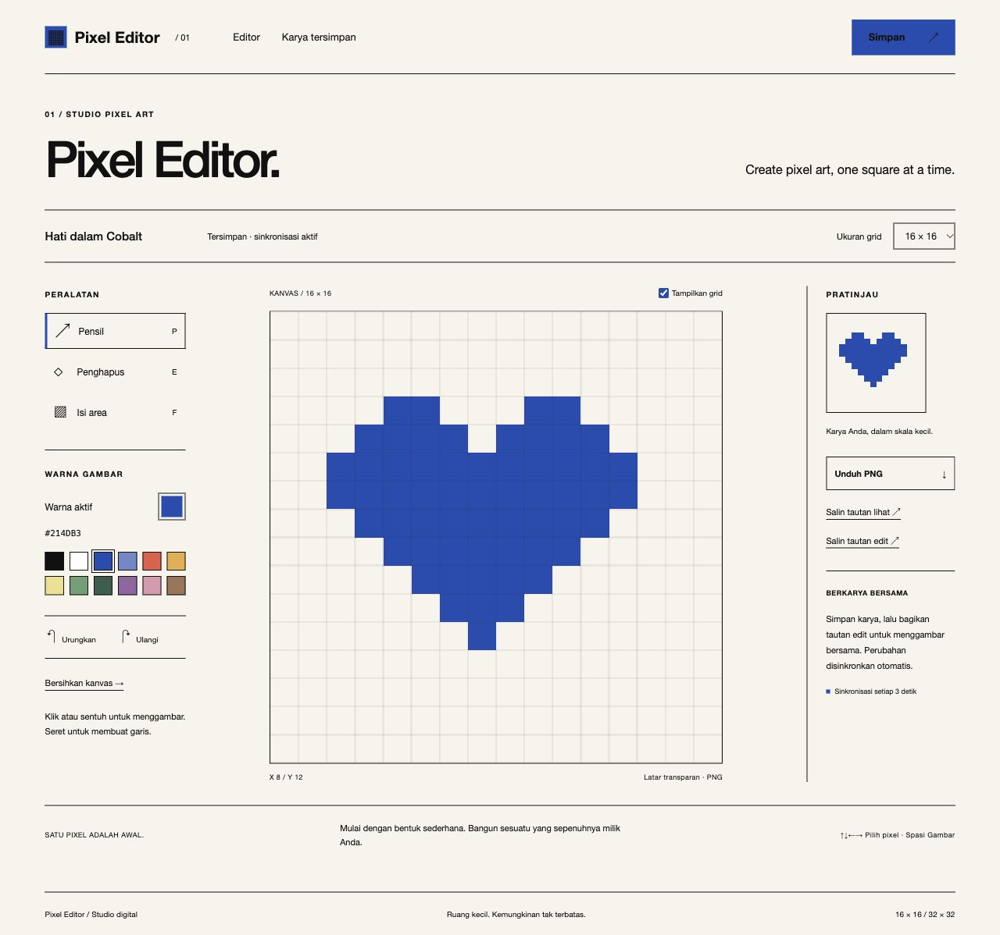

# Pixel Editor

Editor pixel art interaktif berbasis Laravel 13. Antarmuka Swiss Editorial Minimalist memakai Warm White, Cobalt Blue, serta Helvetica Neue dengan teks hitam. Palet gambar menyediakan berbagai warna.



## Fitur

Kanvas 16×16 dan 32×32 mendukung klik, sentuhan, drag, color picker, palet, penghapus, isi area, undo, redo, serta pembersihan dengan konfirmasi. Ekspor PNG transparan berukuran 512×512 tidak menyertakan garis grid. Galeri menyediakan pratinjau, buka, hapus, dan salin tautan.

Karya disimpan di SQLite. Tautan lihat dan edit menggunakan token acak berbeda sepanjang 64 karakter. Pengunjung tautan lihat tidak memperoleh token edit. Koleksi pribadi terhubung dengan sesi browser, bukan akun pengguna; simpan tautan edit untuk mengakses karya dari perangkat lain. Siapa pun yang memiliki tautan edit dapat mengubah karya tersebut.

## Teknologi dan struktur

Laravel 13, Blade, SQLite dengan JSON1, HTML5 Canvas, CSS, Vanilla JavaScript, serta Vite. Controller menangani alur permintaan; Form Request memvalidasi masukan; layanan memisahkan akses dan penyimpanan. Algoritma pixel, sinkronisasi, dialog, dan antarmuka berada dalam modul JavaScript terpisah. Tidak menggunakan framework frontend.

## Instalasi

Diperlukan PHP 8.3+, ekstensi SQLite, Composer, serta Node 22.12+.

```sh
composer install
cp .env.example .env
php artisan key:generate
touch database/database.sqlite
php artisan migrate
npm ci
npm run build
php artisan serve --host=127.0.0.1
```

Buka http://127.0.0.1:8000. Pilih ukuran, warna, dan alat, lalu gambar. Beri nama dan tekan **Simpan**. Setelah tersimpan, perubahan pixel disimpan otomatis. Pergantian ukuran membuat kanvas baru setelah konfirmasi. Pintasan P/E/F memilih alat, Ctrl/Cmd+Z mengurungkan, dan Ctrl/Cmd+S menyimpan.

## Berbagi dan kolaborasi

Salin tautan lihat untuk menampilkan karya atau tautan edit untuk berkolaborasi. Polling berjalan setiap tiga detik saat tab aktif. Pembaruan atomik per pixel mempertahankan perubahan pada pixel berbeda; pixel sama memakai perubahan terakhir yang berhasil disimpan. Perubahan lokal yang belum terkirim dipertahankan saat polling atau kegagalan jaringan. Hindari membagikan token edit secara publik.

## Pengujian

```sh
php artisan test
npm test
npm run build
```

Pengujian mencakup penyimpanan, validasi, isolasi sesi, hak akses, penggabungan pixel, rate limiting, algoritma gambar, dan pemulihan sinkronisasi. CSRF diterapkan pada mutasi. Screenshot berasal dari pengujian browser desktop; tampilan mobile juga diperiksa. `.env`, database, log, dan token lokal tidak disertakan repository.
